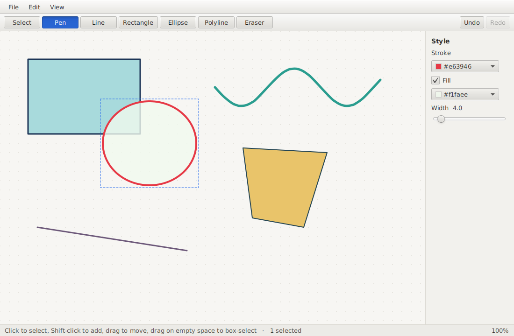

# Paint App

> **Timeline**
> | | |
> |---|---|
> | **Original coursework** | October – November 2024 (University of Toronto, software design course) |
> | **This public rewrite** | October 2026 |
>
> In fall 2024 I built a JavaFX paint program for a university assignment. That code stays private because it's an assessed solution. Paint App was written from scratch in October 2026, with a new architecture, new features, and a full test suite. It's built on the same skills, but none of the old code.

Paint App is a small vector sketching app in Java and JavaFX. You draw strokes and shapes, then select them, move them, restyle them, reorder them, and undo any of it. Drawings save to a readable text format and export to SVG or PNG.



## Features

- **Seven tools**: Select, Pen, Line, Rectangle, Ellipse, Polyline, Eraser. Each has a single-key shortcut (`V P L R E O X`).
  - Pen strokes are simplified with Ramer–Douglas–Peucker when you lift the mouse, then drawn as smooth Catmull-Rom curves.
  - Shift snaps lines to 45° and turns rectangles into squares and ellipses into circles.
  - Polyline: click to place points, then click the first point to close it into a fillable polygon, or double-click / Enter to leave it open.
  - Eraser: drag across elements. Everything you touch fades, and it's all removed as one undo step when you let go.
- **Selection**: click, Shift-click to add or remove, drag on empty space to box-select, drag to move, arrow keys to nudge (Shift for 10 units).
- **Undo/redo** up to 500 steps, with labels in the menu like "Undo Move 3 elements".
- **Styling**: stroke colour, optional fill, and width, applied to the current selection and to anything you draw next.
- **Arrange**: duplicate, delete, bring forward/back, bring to front/back.
- **Zoom and pan**: Ctrl/Cmd + scroll zooms around the cursor, and pinch works on trackpads. Pan with scroll, middle-drag, or Space + drag.
- **Files**:
  - saves to `.paint`, a plain-text format (example below)
  - exports a cropped SVG, or a PNG at 2× resolution
  - warns before you close or open over unsaved work

## Running it

You need JDK 21+ and Maven. Maven downloads JavaFX itself.

```sh
git clone https://github.com/zaidsid08/paint-app.git
cd paint-app
mvn javafx:run      # launch the app
mvn test            # run the test suite
```

## Tests

70 JUnit 5 tests cover everything below the UI layer:

| Area | What's checked |
|---|---|
| Geometry | segment distance, point-in-polygon on concave shapes, bounds math, colour parsing |
| Simplification | collinear points collapse; corners survive; **every dropped point stays within ε of the result** (checked over 2,000 points) |
| Hit-testing | outline vs. fill for rectangles, ellipses, open and closed polylines |
| Commands | undo/redo, redo cleared by new edits, history limit, delete restoring exact z-order, restacking a block of elements |
| Tools | driven with synthetic pointer events through the real `Editor`, e.g. Shift constraints, polygon closing, the eraser being one undo step, moving a multi-selection |
| Files | `.paint` round trip, eight kinds of malformed input each reported with the right line number, SVG parsed back as XML |
| Viewport | zooming keeps the point under the cursor fixed, scale clamping |

The JavaFX classes themselves aren't unit-tested. I checked them by running the app.

## Architecture

```
ui/        JavaFX only: window, canvas, renderer, style panel
  │  turns mouse/keys into calls, paints what the editor holds
  ▼
editor/    Editor (controller) + Viewport            ── no JavaFX below this line
  │
  ├── tool/      Select, Pen, Line, Rect, Ellipse, Polyline, Eraser
  │                 turn gestures into commands
  ├── command/   AddElements, RemoveElements, ReplaceElements, Restack, CommandHistory
  │                 every edit is a reversible command
  ├── model/     Document, Element (sealed), Selection, geometry, RDP, smoothing
  └── io/        .paint reader/writer, SVG exporter
```

The design decisions that shape the rest of the code:

**Immutable elements, sealed hierarchy.** `Element` is a `sealed interface` with five `record` implementations. Moving or restyling an element creates a new record with the same id. That keeps undo small: `ReplaceElements` holds the before and after versions and swaps them. Because the hierarchy is sealed, the renderer, SVG exporter and file writer use exhaustive `switch` pattern matching. If someone adds a sixth element type, the compiler lists every place that needs updating.

**Command pattern for every edit.** Tools never change the document directly. The one exception is the live preview while dragging a selection: the tool moves the elements so you can see them follow the mouse, puts them back on release, and then executes a single `ReplaceElements`. So a 200-event drag is one undo step. `CommandHistory` also remembers which command was on top at the last save. "Unsaved changes" is just *top of undo stack ≠ saved marker*, so undoing back to the saved state clears the dot in the title bar without any extra bookkeeping.

**The UI toolkit stays at the edge.** `Editor` implements the `ToolContext` interface that tools depend on, and tools receive `PointerEvent` records in document coordinates rather than JavaFX `MouseEvent`s. The model has its own `Rgba` type. Everything except `ui/` compiles and runs without JavaFX, which is why the tests can drive tools exactly as the canvas does.

**Strategy-style tools with a template base.** Line, Rectangle and Ellipse share `DragShapeTool`, which handles press/drag/preview/commit and the "ignore accidental clicks" rule. Each subclass only answers one question: given two points and the Shift state, what element is this? The other tools are separate classes because their gestures really are different.

**Screen-space hit tolerance.** A click counts as hitting an element within 5 *screen* pixels, so the tolerance in document units is `5 / zoom`. Thin lines stay just as easy to click at any zoom.

### The `.paint` format

```
paintapp 1
rect 1 stroke=#1d3557ff fill=#a8dadcff width=3 pts=60,60;300,220
pen 2 stroke=#2a9d8fff fill=none width=5 pts=460,120;478,138;...
poly 3 stroke=#264653ff fill=#e9c46aff width=2 closed=true pts=520,250;700,260;650,420;540,400
```

There's one element per line, back to front. I picked text over a binary format or JSON for three reasons: it diffs cleanly in git, you can debug it by eye, and parsing it needs no dependencies. The reader rejects unknown keys, duplicate ids, bad colours and non-finite numbers, and reports the line number. `Editor.open` parses the whole file before it replaces the current drawing, so a corrupt file can't wipe your work. Saves go to a temp file that is then moved into place.

## Possible next steps

- Resize handles on the selection (scale geometry inside `ReplaceElements`)
- Text elements
- Grouping, as a new `Element` variant. The sealed hierarchy would flag every place that needs updating.
- Copy/paste across windows via the system clipboard, using `.paint` lines as the payload

## License

MIT
